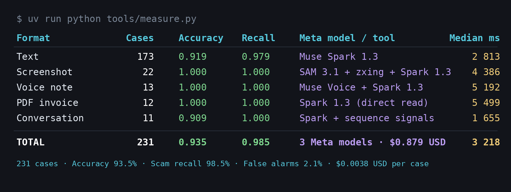
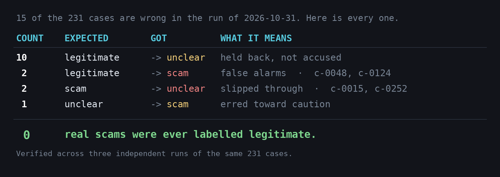

# VIGÍA

*Scam sentinel for small businesses, built during the Meta Global AI Developer Hackathon (Oct 27 – Nov 4, 2026).*

VIGÍA is the WhatsApp number and email address a small business forwards
anything suspicious to — a text, a screenshot, a voice note, a PDF, a link, an
email — and gets back a verdict in plain language in seconds: **scam /
legitimate / doubtful**, why, and what to do. If it's a scam, the rest of the
team is warned too.

**[▶ Watch the three-minute demo](https://www.youtube.com/watch?v=g5TWkJ76fNU)**

## Metrics (latest full run)

Measured by `tools/measure.py` over `evals/casos.jsonl`; the raw result is
`evals/2026-10-31.resultado.json`. `make docs-check` fails if this row drifts
from the newest dated run in `evals/`.

| Date | Cases | Accuracy | Scam recall | False alarms on legit | Doubtful | Cost | Median latency | Commit | Gate |
|---|---|---|---|---|---|---|---|---|---|
| 2026-10-31 | 231 | 93.5% | 98.5% | 2.1% | 6.5% | $0.879 | 3.22 s | `a474a96` | passed, 0 regressions |



In 73 of the 231 cases the deterministic rules were already conclusive, so VIGÍA
skipped the analyst on purpose ([`ADR-061`](docs/decisions/ADR-061.md)): only the
gate's manipulation check called a model, at a median of $0.0015 and 1.5 s per case,
against $0.0047 and 4.0 s with the analyst. In 15 more, Muse Spark read the PDF or
screenshot and the rules decided on the extracted text. The analyst ran in the other 143.
The result file counts those 88 as `degradados` (no analyst); none of the 231 lost
the analyst to an unavailable model or a refusal.

Target (≥80 cases): `recall_estafa ≥ 0.90`, `fp_legitimo ≤ 0.10`,
`dudosos ≤ 0.25`.

**Reproducibility.** The same 231 cases were measured three times
(`evals/2026-10-31.resultado.json`, `evals/2026-11-02-a.resultado.json`,
`evals/2026-11-02-b.resultado.json`). Two results held in all three: scam recall
98.5%, and no real scam was ever labelled legitimate. The rest moves, because a
Meta model is in the loop — 6 of the 231 verdicts changed on each rerun, false
alarms landed at 0, 2 and 3 of the 95 legitimate messages, and accuracy between
92.6% and 93.5%. The row above is the run of 2026-10-31; rerunning `make evals`
will land near it, not exactly on it.



## Run the demo

Needs Docker (with Compose) and [uv](https://docs.astral.sh/uv/).

```
git clone <this repo> && cd vigia
cp .env.example .env   # MODEL_API_KEY is optional; without it the demo runs rules only
make demo
```

Starts Postgres and the API with Docker Compose, seeds a sample business with 3
members, sends 5 sample cases through the local channel, and opens the panel with the
verdicts at `http://localhost:18000/panel?token=<VIGIA_PANEL_TOKEN>` (it prints the full
link). There is no hosted instance: `make demo` on your machine is the way to try it.
The link sets an HttpOnly cookie and redirects to `/panel`, so the token leaves the address
bar. Escape the token if it has `+`, `/` or `=`. Without `MODEL_API_KEY` it says so
and runs rules only (no analyst). The `.env.example` keys are public demo keys:
`VIGIA_MODO=prod` refuses them.

The first `make demo` downloads and builds the Docker images and can take several
minutes; after that it takes seconds. Without `MODEL_API_KEY` VIGÍA never answers
"legitimate" (that call is the analyst's), so the legitimate sample comes out "unclear";
the panel says so. Postgres is published on `127.0.0.1:55432` and the API on
`127.0.0.1:18000`; if either port is taken, set `VIGIA_DB_PORT` or `VIGIA_API_PORT` in
`.env` (and the port in `DATABASE_URL`), run `docker compose down` and `make demo` again.

See `DECLARACION.md` for what was built during the event.

**Everything else you can run.** Only `make demo` and the two eval targets
need Meta API keys. Everything else runs without any configuration.

| Command | What it does | Needs keys |
|---|---|---|
| `make demo` | Brings up the API and walks sample cases through the local channel and the operator panel | yes |
| `make test` | The full test suite | no |
| `make check` | Everything at once: lint, architecture, duplication, security, docs, i18n, web and tests | no |
| `make lint` | `ruff` plus `mypy --strict` over the typed packages | no |
| `make arch` | `lint-imports`: fails if a layer imports one it must not | no |
| `make dup` | `pylint` duplicate-code detection, 8-line threshold | no |
| `make security` | `bandit`, `pip-audit` and the OWASP tests | no |
| `make docs-check` | Fails if docstring coverage drops below 90%, or this README, the repo map or the architecture doc drift from the code | no |
| `make evals` | Re-runs the 231 cases; spends up to $2.00 | yes |
| `make evals-rapido` | A faster subset; up to $1.00 | yes |
| `make db` | Postgres on its own | no |
| `make run` | Everything in the foreground, with build output | no |

## Meta model calls vs code

At runtime (`VIGIA_MODO=eval|prod`) every model call is a Meta model: Muse Spark 1.3
(analyst loop, attachment reading, and the gate's fallback judge), SAM 3.1 (crops), Muse
Voice Transcribe (voice notes). Everything else behind a "model" name is deterministic
code: the country-pack signals, the manipulation floor ([ADR-051](docs/decisions/ADR-051.md)), fusion and policy.

An external non-Meta judge was used during development only (judge of steps) and was
removed from the codebase, so it can never be called at runtime ([ADR-085](docs/decisions/ADR-085.md)). The gate
(`guard/gate.py`) always runs the deterministic floor first; its model fallback is Spark in
`eval`/`prod` and the deterministic mock in `dev`.

## What each Meta model does

| Model | Does |
|---|---|
| Muse Spark 1.3 | The analyst's tool-using loop (web search, pre-resolved link lookup), reading screenshots/PDFs when rules alone aren't enough, and the gate's fallback judge for manipulation scoring at runtime |
| SAM 3.1 | Crops logos and QR codes out of a screenshot; the QR is then decoded in code, not by the model |
| Muse Voice Transcribe | Turns a WhatsApp voice note into text, in code, before any signal or model ever sees it |

## For the judges

Where each judging criterion can be checked in this repo or in the demo:

| Criterion | Weight | Where to see it |
|---|---|---|
| Impact | 30% | A small business with no security team gets a verdict on WhatsApp with no app to install; the whole team is warned on a scam (`src/vigia/services/whatsapp.py`, `make demo`) |
| Meta tooling | 25% | Muse Spark as a tool-using analyst (`src/vigia/analyst/loop.py`), SAM 3.1 crops with the QR decoded in code, Muse Voice Transcribe for voice notes (see "What each Meta model does" above) |
| Demo | 25% | `make demo`: sample cases through the local channel and the operator panel with their verdicts |
| Technical | 20% | Measured accuracy with a regression gate (`tools/measure.py`, the metrics row above), adversarial and blind evals (`evals/adversarios.jsonl`, `evals/ciego-01.md`), row-level security and encryption (`docs/ARCHITECTURE.md`, `docs/THREAT_MODEL.md`), every decision as an ADR (`docs/decisions/`) |

## Security

OWASP categories this repo tests for, mapped to the test that covers them:

| OWASP category | Covered by |
|---|---|
| A01 — Broken access control | `tests/test_owasp.py` (`test_a01_business_sees_only_its_own_rows`, `test_a01_without_business_context_no_rows_are_visible`, `test_a01_cannot_write_rows_for_another_business`) |
| A03 — Injection | `tests/test_owasp.py` (`test_a03_detector_flags_runtime_built_queries`, `test_a03_no_runtime_built_sql_in_src`, `test_a03_business_id_is_bound_not_interpolated`) |
| A05 — Security misconfiguration | `tests/test_owasp.py` (`test_a05_security_headers_are_set`, `test_a05_no_api_docs_in_prod`, `test_a05_public_texts_never_name_internal_signals`) |
| A09 — Logging and monitoring failures | `tests/test_owasp.py` (`test_a09_case_logs_carry_ids_but_no_pii`, `test_a09_uvicorn_errors_are_json_without_pii`) |
| A10 — Server-side request forgery | `tests/test_net.py`, over `src/vigia/net/unroll.py` ([ADR-099](docs/decisions/ADR-099.md)): short-link unrolling refuses non-public addresses, caps hops and time, never forwards cookies |

`make check` runs `pip-audit` as part of `security`, and it's blocking: any real vulnerability fails the build. It needs network access to fetch the vulnerability database; without it, the check detects the missing connection and skips with "pip-audit: omitido, sin conexión" instead of failing for an unrelated reason (D-124).

Full write-up: [`docs/THREAT_MODEL.md`](docs/THREAT_MODEL.md) and
[`docs/PRIVACY.md`](docs/PRIVACY.md); encryption design in
[`ADR-020`](docs/decisions/ADR-020.md) and [`ADR-025`](docs/decisions/ADR-025.md);
how to report a vulnerability in
[`SECURITY.md`](SECURITY.md).

## Out of scope

Not goals of this hackathon build: monetization, full multi-country coverage,
an MCP server for third parties, auditing third-party chatbots, zero-click
attacks, and a published benchmark.

## License

MIT — see [`LICENSE`](LICENSE).

## More

- [`docs/MAP.md`](docs/MAP.md) — one line per module, its layer and
  responsibility.
- [`docs/ARCHITECTURE.md`](docs/ARCHITECTURE.md) — component and flow
  diagrams, import contracts, multi-tenancy.
- API reference: generated locally with `make docs` (`pdoc`, into `docs/api/`).
- [`docs/decisions/`](docs/decisions/) — every technical decision (ADR-001
  through ADR-112), migrated to English from the working decision log.
