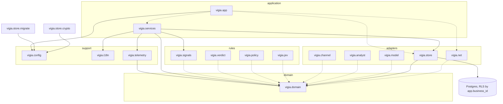
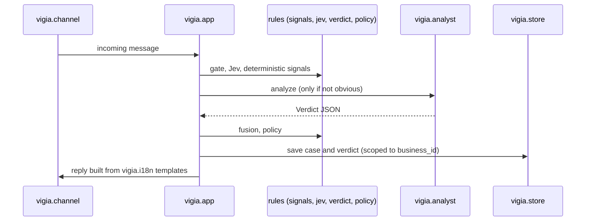

# Architecture

VIGIA is one FastAPI service (`vigia.app`) backed by Postgres with row-level security per
business. This document grows with the code; `tools/check_architecture_doc.py` fails the
build if a top-level package under `src/vigia` is missing from the diagrams below.

## Components

Legend: solid arrow (`-->`) = import that exists today; dotted arrow (`-.->`) = target
dependency, allowed by the import contracts but not written yet.

## Flow of a case (target, built task by task)

## Import contracts (`.importlinter`, checked by `make arch`)

- `domain-is-pure`: `vigia.domain` imports nothing else from `vigia`.
- `rules-see-only-domain`: `signals`, `verdict`, `policy`, `jev` never import adapters,
  services or the app.
- `adapters-are-independent`: `channel`, `analyst`, `model`, `store`, `net` do not import each other.
  `net` follows short links hop by hop and refuses non-public addresses (D-099).
- `nobody-imports-app`: only the process entrypoint loads `vigia.app`.

## Multi-tenancy

Every tenant table has `business_id` with `ENABLE` + `FORCE ROW LEVEL SECURITY` and a policy
on `current_setting('app.business_id')`. The API connects as `vigia_app` (no superuser, no
`BYPASSRLS`) and scopes each transaction with `vigia.store.db.set_business`. Migrations run
as the schema owner from a separate one-shot `migrate` service.
